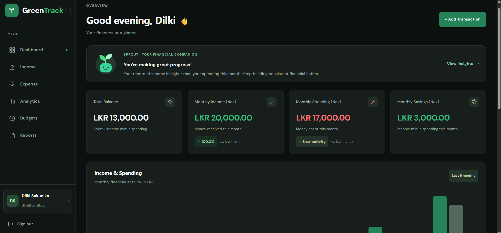
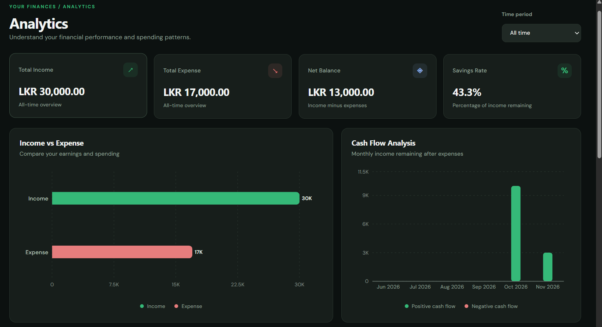
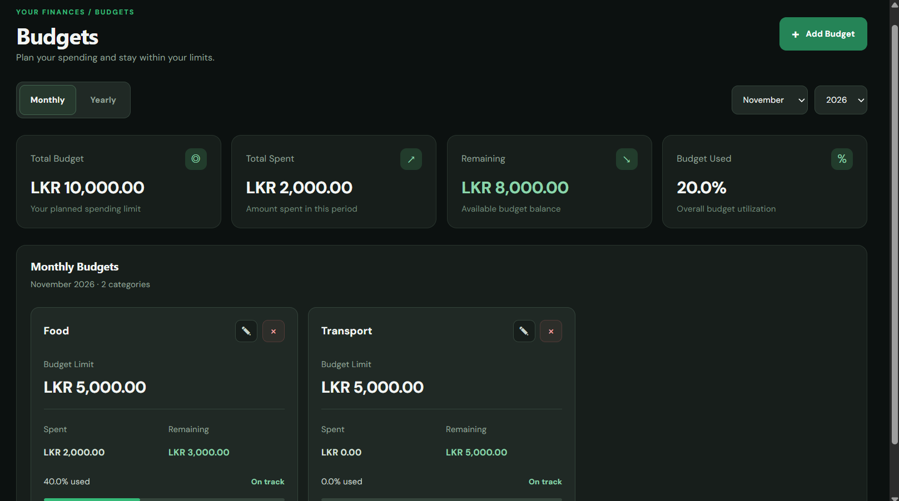
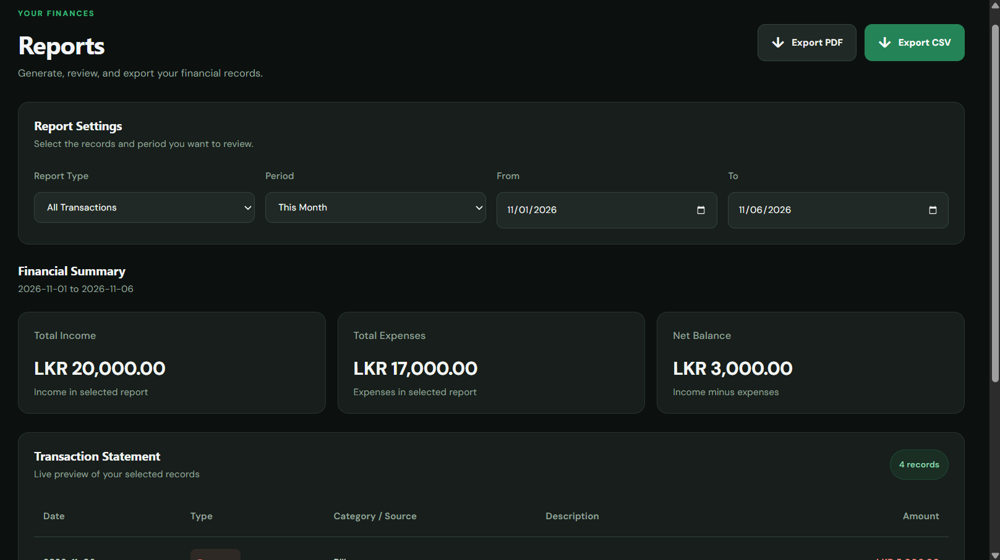

# 🌱 GreenTrack

**Personal Finance Management | MERN Stack**

GreenTrack is a full-stack personal finance application for tracking income and expenses, managing budgets, and understanding financial activity through interactive analytics. It supports transactions in multiple currencies and presents consolidated summaries in the user's preferred base currency.

[**Live Demo**](https://green-track-pink.vercel.app/) · [**Source Code**](https://github.com/Sehansa03/GreenTrack)

## Application Preview



## Features

- **Income & expense tracking:** Record, organize, and manage transactions with amounts, dates, categories or sources, descriptions, and currencies.
- **Multi-currency management:** Record transactions in different currencies and view converted totals in a preferred base currency, which can be changed from the user profile.
- **Budget management:** Create budgets and monitor spending against planned limits.
- **Financial dashboard:** View income, expenses, and balance in one place.
- **Interactive analytics:** Explore monthly financial trends, income-versus-expense comparisons, expense distributions, and financial insights.
- **Financial reports:** Review financial summaries and download reports.
- **User accounts:** Register, sign in, and manage profile information with JWT-based authentication and password hashing.
- **Responsive interface:** Use the application on desktop and mobile with adaptable navigation.

## Screenshots

### Financial Analytics


### Budget Management


### Financial Reports


## Tech Stack

| Layer | Technologies |
| --- | --- |
| Frontend | React, Vite, JavaScript |
| Styling | Tailwind CSS, CSS |
| Backend | Node.js, Express.js |
| Database | MongoDB, Mongoose |
| Authentication | JWT, bcrypt |
| API communication | Axios |
| Data visualization | Recharts |
| Deployment | Vercel, Render, MongoDB Atlas |

## Project Structure

```text
GreenTrack/
├── frontend/
│   ├── src/
│   │   ├── api/
│   │   ├── components/
│   │   ├── context/
│   │   ├── data/
│   │   ├── pages/
│   │   └── App.jsx
│   └── package.json
├── backend/
│   ├── controllers/
│   ├── models/
│   ├── routes/
│   └── package.json
├── screenshots/
│   ├── dashboard.png
│   ├── analytics.png
│   ├── budgets.png
│   └── reports.png
└── README.md
```

## Getting Started

### Prerequisites

- Node.js and npm
- Git
- MongoDB (local or MongoDB Atlas)

### Clone the repository

```bash
git clone https://github.com/Sehansa03/GreenTrack.git
cd GreenTrack
```

### Backend

```bash
cd backend
npm install
```

Create `backend/.env` and configure the MongoDB connection, JWT secret, and other required settings using the variable names referenced in the backend source code.

Start the backend in development mode:

```bash
npm run dev
```

Alternatively, use:

```bash
npm start
```

### Frontend

From the repository root, in another terminal:

```bash
cd frontend
npm install
npm run dev
```

The frontend uses `VITE_API_URL` to configure the backend API endpoint. If this variable is not set, the default API URL is `http://localhost:5000/api`.

To use a different backend URL, configure `VITE_API_URL` in `frontend/.env`. Open the local address shown by Vite.


## Deployment

| Service | Platform |
| --- | --- |
| Frontend | [Vercel](https://green-track-pink.vercel.app/) |
| Backend | Render |
| Database | MongoDB Atlas |

## About the Project

GreenTrack was developed as a software engineering portfolio project, applying full-stack development, REST API integration, database design, authentication, currency handling, financial data visualization, and responsive UI development.

---

Built with 💚 using the MERN stack.
